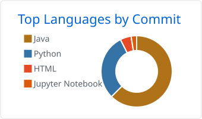

### Seja bem-vindo 👋

Atuo como arquiteto de software, com foco em integração de sistemas: projeto e construo APIs e serviços em **Node.js, TypeScript e NestJS** que conectam ERPs como **SAP S/4HANA** e **Coupa**. Também uso IA no desenvolvimento e na automação de processos. Gosto de entender o problema a fundo e entregar soluções que funcionem bem em produção, com testes, CI/CD e deploy em containers.

🇺🇸 English

 

I work as a software architect, focused on systems integration: I design and build APIs and services in **Node.js, TypeScript, and NestJS** that connect ERPs such as **SAP S/4HANA** and **Coupa**. I also use AI in software development and process automation. I enjoy getting to the root of a problem and delivering solutions that run reliably in production, backed by tests, CI/CD, and container-based deployments.

#### 🛠️ Stack

<!-- Ícones disponíveis em https://skillicons.dev -->

**Também:** SQL Server · SAP S/4HANA (OData) · Coupa API · Docker Swarm · OAuth2 / JWT

 

---

  <picture>
    <source media="(prefers-color-scheme: dark)" srcset="https://raw.githubusercontent.com/IgorFrutuoso/IgorFrutuoso/main/profile-summary-card-output/github_dark/3-stats.svg">
    
  </picture>
  <picture>
    <source media="(prefers-color-scheme: dark)" srcset="https://raw.githubusercontent.com/IgorFrutuoso/IgorFrutuoso/main/profile-summary-card-output/github_dark/2-most-commit-language.svg">
    
  </picture>

 

<picture>
  <source media="(prefers-color-scheme: dark)" srcset="https://raw.githubusercontent.com/IgorFrutuoso/IgorFrutuoso/output/github-snake-dark.svg">
  
</picture>

---

#### 📫 Contato

