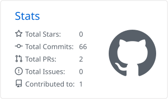

### Seja bem-vindo 👋

<!-- Apresentação: em breve -->

#### 🛠️ Stack

<!-- Stack: atualizar a lista em ?i= (ícones disponíveis em https://skillicons.dev) -->

 

---

  <picture>
    <source media="(prefers-color-scheme: dark)" srcset="https://raw.githubusercontent.com/IgorFrutuoso/IgorFrutuoso/main/profile-summary-card-output/github_dark/3-stats.svg">
    
  </picture>
  <picture>
    <source media="(prefers-color-scheme: dark)" srcset="https://raw.githubusercontent.com/IgorFrutuoso/IgorFrutuoso/main/profile-summary-card-output/github_dark/2-most-commit-language.svg">
    
  </picture>

 

<picture>
  <source media="(prefers-color-scheme: dark)" srcset="https://raw.githubusercontent.com/IgorFrutuoso/IgorFrutuoso/output/github-snake-dark.svg">
  
</picture>

---

#### 📫 Contato

